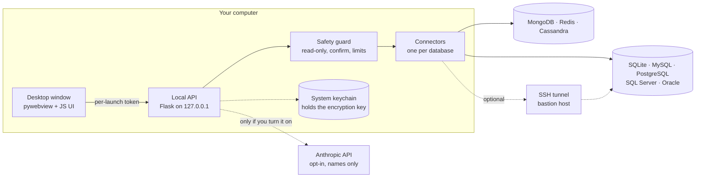
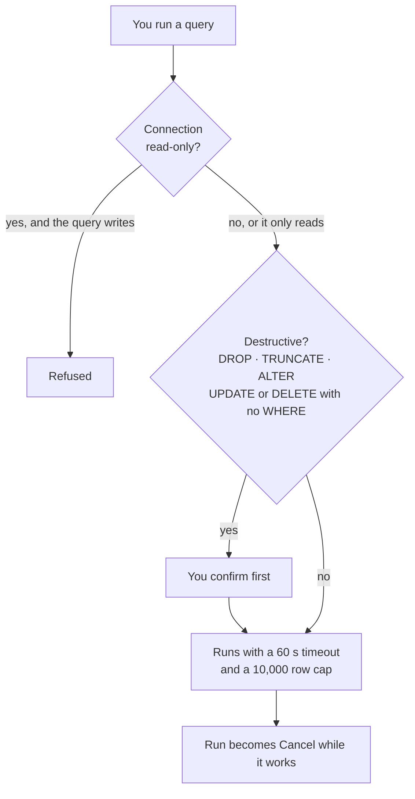
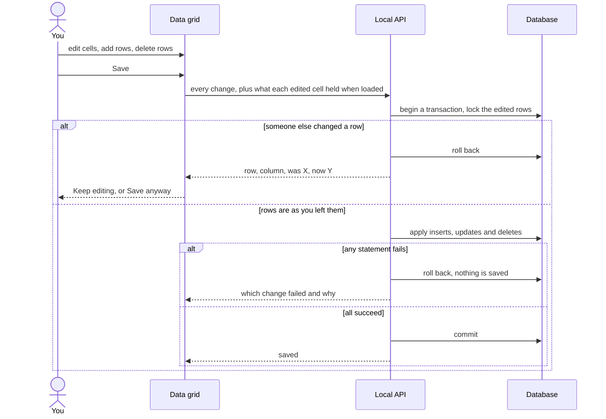
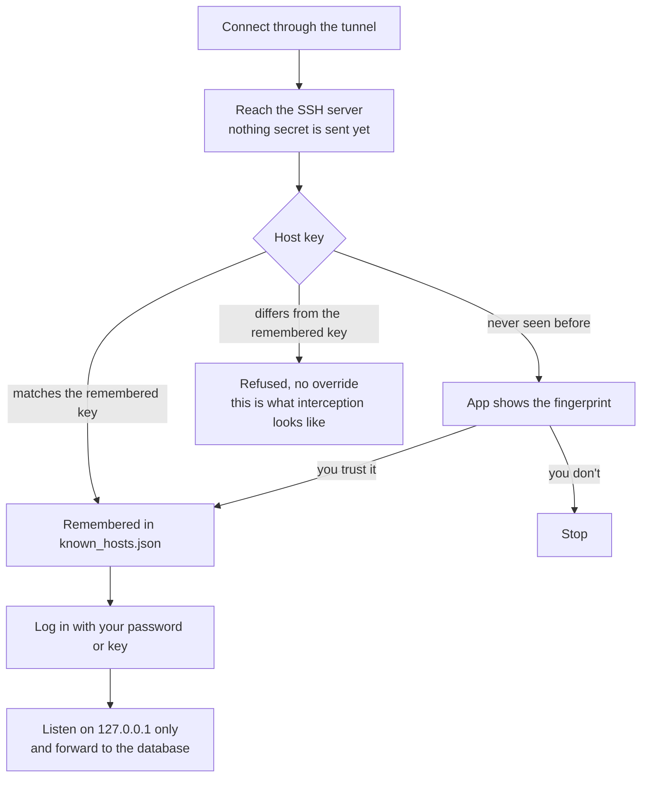
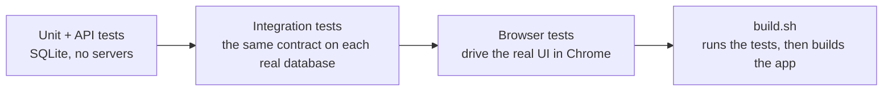

<div align="center">

# 🗄️ DB Visualizer

**Look at your data, follow its relationships, and change it without being afraid of it.**

A desktop app for browsing and editing SQL and NoSQL databases, with guard rails that stop the expensive mistakes.


[](../../actions/workflows/ci.yml)

[Quick start](#-quick-start) ·
[What it does](#-what-it-does) ·
[How it works](#-how-it-works) ·
[Safety](#-safety-rails) ·
[Databases](#-databases) ·
[Security](#-security) ·
[Develop](#-develop)

</div>

---

## ⚡ Quick start

```bash
./run.sh
```

No database handy? Click **Try a sample database** on the first screen. It opens a small online shop you can't hurt.

<details>
<summary><b>Install by hand</b> (if you don't want the script)</summary>

```bash
# Use a venv; the system pip on macOS can't build pyobjc (needed by pywebview)
python3 -m venv .venv
.venv/bin/python -m pip install -U pip -r requirements.txt
.venv/bin/python db.py
```
</details>

**Your first five minutes**

| Step | Do this |
|:--:|---|
| 1 | Click **+** in the sidebar, pick the database type, fill in the details, **Test Connection**, **Save** |
| 2 | Click the ○ next to the connection. The database tree loads |
| 3 | Double-click a table to see its data, or write SQL in the editor |
| 4 | **⌘/Ctrl + Enter** runs the query |
| 5 | Press **⌘K / Ctrl K** any time to jump to a table, tab, connection or action |

---

## ✨ What it does

<table>
<tr>
<td width="50%" valign="top">

### 🔗 Follow the data
A value that points at another table (a foreign key) shows **↗**: click it to open exactly that row. A value that other tables point at shows **↘**: click it to see who refers to it. Hold ⌘/Ctrl and click anywhere in a cell to follow it.

</td>
<td width="50%" valign="top">

### 🗺️ Schema map
Every table that takes part in a relationship, parents on the left and children on the right. Hover to light up what a table touches, drag to pan, scroll to zoom, click a table to open it.

</td>
</tr>
<tr>
<td valign="top">

### 📊 Column insights
The **▾** on a column header shows empty and distinct counts, range, average, a histogram and the most common values. Click a common value to filter the table to it. Big tables are sampled.

</td>
<td valign="top">

### 🎨 Environments
Mark a connection Local, Development, Staging or Production. The window takes on that colour, and Production starts read-only and asks before saving or running anything destructive.

</td>
</tr>
<tr>
<td valign="top">

### ✏️ Safe editing
Edit cells in the grid, add rows, delete rows, then save. It all happens together or not at all, and it refuses to overwrite a row someone else changed. [See how](#-saving-edits-safely).

</td>
<td valign="top">

### 🤖 SQL assistant <sub>optional, off by default</sub>
Describe a query in plain English and Claude writes it into the editor. It only ever sees names, never data. [See exactly what is sent](#-sql-assistant).

</td>
</tr>
</table>

Also in the box: SSH tunnels, read-only connections, a query editor with autocomplete, a data grid with search, sorting and paging, a schema viewer, CSV/JSON export, query history, and a dark theme.

---

## 🧭 How it works

Everything runs on your machine. The window talks to a small local server that only answers to itself.



<details>
<summary><b>Where things live</b></summary>

| What | Where |
|---|---|
| Server, routes, safety wiring | `db.py` |
| One connector per database | `db_connectors/` (`base`, `safety`, `tunnel`, `sqlite`, `mysql`, `postgres`, `sqlserver`, `oracle`, `mongodb`, `redis`, `cassandra`) |
| UI | `static/js/` (`app`, `connection`, `query`, `tabs`, `ui`, `palette`, `relations`, `insights`, `assistant`) |
| SQL assistant | `ai_assistant.py` |
| Sample shop database | `sample_data.py` |
| Your data | `~/Library/Application Support/DB Visualizer` (saved connections, `app.log`, known SSH hosts) |

</details>

---

## 🛡️ Safety rails

Every query passes through the same gate before it reaches your database.



| Rail | What it does |
|---|---|
| **Read-only connections** | The server rejects inserts, updates, deletes and schema changes, in the editor and the grid alike. PostgreSQL, MySQL and SQLite also refuse writes in the driver. It can't see side effects hidden inside functions, so for production data also use a database user that only has `SELECT`. |
| **Confirmation** | `UPDATE`/`DELETE` without a real `WHERE`, `DROP`, `TRUNCATE`, `ALTER` and Redis `FLUSH*` ask first. Nothing runs until you agree. |
| **Limits** | Results are capped at 10,000 rows and queries stop after 60 seconds (`DBV_QUERY_TIMEOUT`, `0` turns it off). |
| **Cancel** | Works on PostgreSQL, MySQL, SQLite and Oracle. SQL Server, MongoDB, Redis and Cassandra can't stop a running query, and the timeout doesn't apply there either. |
| **Reconnect** | A connection that sat idle or was dropped by the server is re-opened automatically. |

### 💾 Saving edits safely

Saving a grid is one request, checked against what you saw when you loaded it.



- **All or nothing** on SQLite, MySQL, PostgreSQL, SQL Server and Oracle.
- **MongoDB, Redis and Cassandra can't roll back.** They stop at the first failure and tell you how many changes were applied.
- A row that was already deleted doesn't block a delete. An edit to a row that no longer exists is reported.
- Updates and deletes that match no row are failures, never silent successes.

---

## 🗃️ Databases

| | SQLite | MySQL | PostgreSQL | SQL Server | Oracle | MongoDB | Redis | Cassandra |
|---|:--:|:--:|:--:|:--:|:--:|:--:|:--:|:--:|
| Browse, edit, query | ✅ | ✅ | ✅ | ✅ | ✅ | ✅ | ✅ | ✅ |
| Atomic saves + stale-edit check | ✅ | ✅ | ✅ | ✅ | ✅ | – | – | – |
| Cancel a running query | ✅ | ✅ | ✅ | – | ✅ | – | – | – |
| Driver refuses writes when read-only | ✅ | ✅ | ✅ | – | – | – | – | – |
| Tested against a real server | ✅ | ✅ | ✅ | ✅ <sup>1</sup> | ✅ <sup>2</sup> | ✅ | ✅ | ✅ |
| Tested through an SSH tunnel | n/a | ✅ | ✅ | – | – | ✅ | ✅ | ✅ |

<sup>1</sup> Azure SQL Edge, which runs natively on Apple Silicon. The regular SQL Server image is amd64-only. &nbsp; <sup>2</sup> Oracle 23ai Free only.

Cassandra has no `LIKE` or arbitrary sort, so search and sort are skipped there by design.

<details>
<summary><b>Database-specific notes</b></summary>

- **SQLite** only needs a file path. Row counts are exact for files under 50 MB.
- **Row counts elsewhere** are catalog estimates, shown with `~`, so connecting never scans your tables.
- **Oracle** uses python-oracledb in thin mode, so no Oracle Instant Client is needed.
- **SQL Server**: the pymssql wheels bundle FreeTDS. Install it separately only if pip has to build pymssql from source.
- **PostgreSQL / MySQL**: make sure the server is running and reachable.
- **JSON fields** appear in monospace.
</details>

---

## 🔌 SSH tunnels

Tick **Connect through an SSH tunnel** to reach a database that is only visible from an SSH server (a bastion or jump host). Enter the SSH server, your user, and a password or a private key file. The database **host and port are as seen from the SSH server**, e.g. `localhost`.



- The tunnel closes when you disconnect or delete the connection, and re-opens on the same port if SSH drops.
- SSH passwords and passphrases are encrypted like database passwords. A key file stays where it is; only its path is saved.
- If you know a server was reinstalled, remove its entry from `known_hosts.json` in the data folder.
- **Not supported:** SSH agent or hardware keys, jump chains (`ProxyJump`), and MongoDB or Redis connections that use a URL (use host and port). The SSH server must allow `AllowTcpForwarding yes`.

---

## 🤖 SQL assistant

Off until you turn it on (**Ask** in a query tab, or ⌘K → *SQL assistant settings*) with your own Anthropic API key. The key is stored encrypted on this computer and billed to your Anthropic account.

| Sent to the Anthropic API | Never sent |
|---|---|
| The database type | Row data and query results |
| The *names* of tables and columns | Passwords |
| The foreign keys between them | Hosts and file paths |
| The text you type | |

- **Show what's sent** prints the exact text without sending it.
- It only **writes** SQL into the editor and never runs it. The statement is labelled *Reads data only*, *Changes data*, or a warning for `UPDATE`/`DELETE` without a `WHERE`. Running it goes through the usual confirmations and the read-only and production protections.
- For a large schema, only the tables your request seems to be about are described in full.
- Model: `claude-opus-5-5` by default (`DBV_AI_MODEL` to change). `DBV_AI_BASE_URL` points it at another endpoint.
- It needs an internet connection. A rejected key, a rate limit or an unreachable API is reported in the panel.

---

## 🔐 Security

- **Passwords are encrypted** with Fernet. The key lives in the **system keychain** (macOS Keychain, Windows Credential Manager, Secret Service), not in a file. An existing `secret.key` is moved there on first run (checked by reading it back) and then deleted.
- **No usable keychain?** The key stays in `secret.key` (`0600`). With an explicit `DBV_DATA_DIR` (portable or test setups) the key stays in that folder and the keychain isn't touched. `DBV_KEY_STORE=keychain|file` overrides this.
- **The key is never replaced once it exists.** A locked or unreadable keychain stops the app with a clear message instead of inventing a new key that would orphan every saved password.
- **Back up carefully.** `connections.json` is useless without the key. Lose the keychain item and your saved passwords are gone (the connections remain; re-enter the passwords).
- The data folder is `0700`; `connections.json` is `0600`.
- **The UI talks to `127.0.0.1` only.** Every `/api` call needs a per-launch token and a loopback `Host` header, and CORS is off, so other local processes and web pages can't reach your databases.
- Table and column names are quoted for each database, never pasted into SQL, and values are always parameters.
- Logs go to `app.log` in the data folder (rotated) and contain no row data. `DBV_DEBUG=1` opens the web inspector.
- Anyone who can run code as your user can still ask the keychain for the key. This protects the file at rest, not a compromised account.

---

## ⌨️ Shortcuts

| Keys | Does |
|---|---|
| `⌘/Ctrl + K` | Jump to a table, connection, tab or action |
| `⌘/Ctrl + Enter` | Run the query |
| `Esc` | Close a dialog |
| `Tab` | Move between fields |

---

## 🧪 Develop



```bash
.venv/bin/python -m pytest tests --ignore=tests/e2e        # unit and API tests, no servers needed
.venv/bin/python -m pytest tests/e2e                       # browser tests (needs Playwright + Chrome)
python tests/ssh_fixture/make_keys.py                      # once: throwaway SSH keys for the tunnel tests (never committed)
docker compose -f docker-compose.test.yml up -d --wait     # MySQL, PostgreSQL, SQL Server, Oracle, MongoDB, Redis, Cassandra, SSH
.venv/bin/python -m pytest tests/integration               # the same contract against each real database
./build.sh                                                 # runs the tests, then builds dist/DB Visualizer.app
```

GitHub Actions runs the unit, real-database and browser tests on Linux, and builds the macOS app, on every push and pull request.

<details>
<summary><b>Status: what is and isn't verified</b></summary>

| | |
|---|---|
| ✅ Tested | All eight databases against real servers; SSH tunnels; the browser UI; the macOS build in CI |
| ⚠️ The macOS app is **unsigned** | To distribute it, sign and notarize it with an Apple Developer ID |
| ⚠️ Not tested | Windows. SQL Server and Oracle through an SSH tunnel. The SQL assistant against the live Anthropic API (tests use a local fake) |
| ⚠️ Different from production | SQL Server tests use Azure SQL Edge; Oracle tests use 23ai Free |

</details>

<details>
<summary><b>Troubleshooting</b></summary>

**`pip: command not found`** — use `pip3` on macOS.

**Module not found** — install everything: `pip3 install --upgrade -r requirements.txt`.

**Can't connect** — check the server is running, the port is reachable, and (for a bastion) that SSH allows TCP forwarding.

**Lost saved passwords** — they're encrypted with a key in your keychain. If that item is gone, re-enter the passwords; the connections themselves are kept.
</details>

---

<div align="center">

A custom database visualization tool, built for browsing and managing databases with fewer regrets.

</div>
